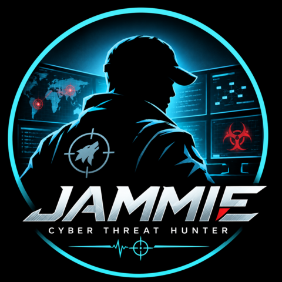

<h1>iamjammie</h1>

<strong>INTELLIGENCE&nbsp;·&nbsp;HUNTING&nbsp;·&nbsp;RESILIENCE</strong>

Threat hunter &amp; blue-team practitioner — building open-source, offline, MITRE&nbsp;ATT&amp;CK-mapped tooling and knowledge.

<a href="https://iamjammie.github.io/FluxHunt/suite.html"><strong>▶&nbsp;The&nbsp;Hunt&nbsp;suite</strong></a> ·
<a href="https://iamjammie.github.io/hunt-sage/">Hunt-Sage&nbsp;site</a>

---

## 🧰 Projects

| | Project | What it is |
|---|---|---|
| 🧠 | **[Hunt-Sage](https://github.com/iamjammie/hunt-sage)** | The one-stop **threat-hunting knowledge hub** — theory, 25 playbooks (KQL + SPL), 6 scenario hunt packs, 43 ATT&CK-mapped Sigma rules, a playbook finder, cheat sheets, labs and a blue-team CTF. [Site →](https://iamjammie.github.io/hunt-sage/) |
| 🌊 | **[FluxHunt](https://github.com/iamjammie/FluxHunt)** | *Hunting threats through traffic patterns* — a single-file, fully offline **PCAP analysis & IR** workbench in the browser. 35+ ATT&CK-mapped detectors, attack map, object export, reports. [Live demo →](https://iamjammie.github.io/FluxHunt/) |
| 🖥️ | **[HostHunt](https://github.com/iamjammie/HostHunt)** | *Hunting threats through host artefacts* — a dependency-free Python **host/endpoint triage** tool. 43 ATT&CK-mapped rules, live Windows/Linux collectors, IOC sweep, fleet stacking, HTML/JSON/Markdown reports. |
| 🛰️ | **[SPECTRA](https://github.com/iamjammie/SPECTRA---Space-Cyber-Framework)** | A mission-first **space-systems cyber** assessment framework built around attack-path state transitions (Mission → Exposure → … → Resilience). |
| 🔦 | **[Photonwire](https://github.com/iamjammie/Photonwire)** | *Offline file transfer across an air gap, by screen and camera* — two self-contained HTML files: the isolated machine shows a file as a loop of QR codes, a phone reads it back, verifies the SHA-256 and shares it. Own QR encoder/decoder, zero network. |

> 🔗 See the tools and knowledge together on the **[Hunt suite hub](https://iamjammie.github.io/FluxHunt/suite.html)** — from the wire, to the box, to the playbook.

---

## 🛡️ Focus Areas

`Threat Hunting` · `Detection Engineering` · `Incident Response` · `MITRE ATT&CK` · `SIEM/EDR` · `Blue Team`

---

## 📊 Latest from Hunt-Sage

<!-- These update when you publish new posts -->
- 📝 [Hunting Persistence: Every Place an Attacker Can Survive a Reboot](https://iamjammie.github.io/hunt-sage/blog/hunting-persistence)
- 📝 [Hunting C2 Beaconing: Finding the Heartbeat in Your Network Traffic](https://iamjammie.github.io/hunt-sage/blog/hunting-c2-beaconing)
- 📝 [Case Study: The Argon Dynamics Data Spill](https://iamjammie.github.io/hunt-sage/blog/argon-dynamics-case-study)
- 🚩 [CTF: Argon Nexus Challenge](https://iamjammie.github.io/hunt-sage/ctf/argon-nexus/)

---

## 📬 Connect

